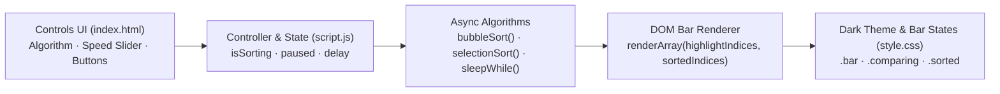

<div align="center">
  <h1>AlgoViz</h1>

  <p>
    <strong>Lightweight browser-based sorting algorithm visualizer built with vanilla HTML5, CSS3, and JavaScript — zero dependencies required.</strong>
  </p>

  <p>
    
    
    
    
    
  </p>
</div>

---

## Overview

**AlgoViz** is a self-contained, zero-dependency web application for visually exploring how classic sorting algorithms operate step-by-step on randomly generated bar charts.

Built entirely with native DOM manipulation, CSS Flexbox, and `async`/`await` animation pacing, it opens directly in any modern browser without a build tool, bundler, or backend server.

---

## Screenshots

<div align="center">
  <table>
    <tr>
      <td align="center"><strong>Sorting Visualizer UI</strong></td>
    </tr>
    <tr>
      <td></td>
    </tr>
  </table>
</div>

---

## Key Features

- **Step-by-Step Sorting Visualizations**: Animates every element comparison and swap for **Bubble Sort** (with early-exit termination when a pass performs zero swaps) and **Selection Sort**.
- **Real-Time Speed Control**: An interactive range slider (`1–100`) maps dynamically to a `500 ms`–`5 ms` delay per step (`delay = 505 - value * 5`) and responds immediately while sorting is running.
- **Interactive Playback Controls**: Generate fresh 40-element arrays (`5–104`), `Start` execution, toggle `Pause` / `Resume` mid-sort via `sleepWhile()`, and `Reset` cleanly back to an unsorted array while `setControlsDisabled()` prevents conflicting actions.
- **Color-Coded Bar States**: Clear dark-mode visual feedback differentiates active comparisons/swaps (`.comparing`, `#f97316` orange), confirmed sorted positions (`.sorted`, `#3b82f6` blue), and remaining unsorted bars (`.bar`, `#10b981` green).
- **Zero-Dependency Static Architecture**: Consists solely of `index.html`, `style.css`, and `script.js` — no frameworks, npm packages, or compilation required.

---

## Architecture

AlgoViz keeps markup, theme/state styling, and async visualization logic cleanly separated across three static files:



### Algorithm & State Reference

| Algorithm / Class | Complexity / Color | Behavior |
| --- | --- | --- |
| **Bubble Sort** (`bubbleSort`) | Best `O(n)` · Avg/Worst `O(n²)` · Space `O(1)` | Adjacent comparisons and swaps with early-exit flag when a full pass completes with no swaps |
| **Selection Sort** (`selectionSort`) | Best/Avg/Worst `O(n²)` · Space `O(1)` | Tracks the minimum index across the unsorted suffix and swaps it into place each pass |
| `.bar` | `#10b981` (Green) | Default unsorted bar scaled proportionally to `Math.max(...data, 100)` |
| `.bar.comparing` | `#f97316` (Orange) | Pair of indices currently being compared or swapped |
| `.bar.sorted` | `#3b82f6` (Blue) | Indices locked into their final sorted position |

---

## Tech Stack

| Layer | Technology | Details |
| --- | --- | --- |
| Markup | HTML5 | Semantic toolbar controls (`#controls`) and bar viewport (`#barsContainer`) |
| Styling | CSS3 | Flexbox bar alignment, dark theme (`#111827` / `#1f2937`), state classes |
| Logic & Animation | Vanilla JavaScript (`ES6+`) | `async`/`await` step loop with interruptible `sleepWhile()` pause/reset support |
| Runtime | Any modern web browser | Zero external dependencies or build steps |

---

## Project Structure

```text
Simp_algo_vis/
├── index.html   # Page layout, algorithm selector, speed slider, and playback buttons
├── script.js    # Array generation, DOM rendering, pause/reset state, and sorting algorithms
├── style.css    # Dark-mode layout and bar state color styling
└── README.md    # Project documentation
```

---

## Getting Started

### Prerequisites

- Any modern web browser (Chrome, Firefox, Edge, Safari) — no Node.js or build tools required.

### 1. Clone the Repository

```shell
git clone https://github.com/Paul1708/Simp_algo_vis.git
```

### 2. Open in Browser

Open [`index.html`](index.html) directly in your browser, or serve the folder locally with any static server:

```shell
cd Simp_algo_vis
python -m http.server 8000
```

Then navigate to `http://localhost:8000`, pick **Bubble Sort** or **Selection Sort**, adjust the **Speed** slider, and click **Start**.

---

## License

This project is licensed under the MIT License.
